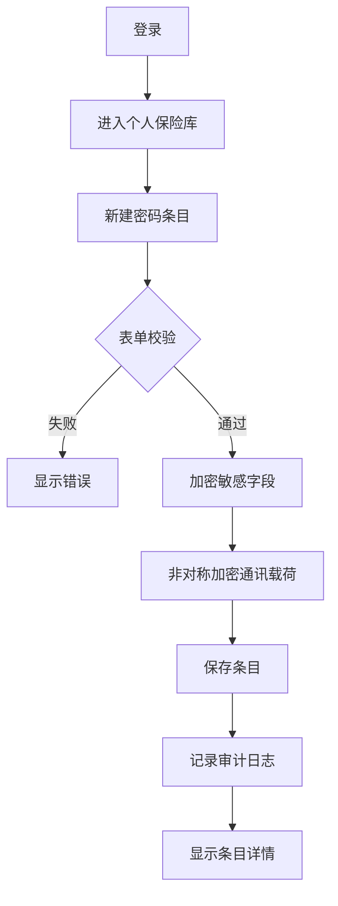

# 用户场景与流程

## 用户角色

- 访客：未登录用户，可注册、登录或进入找回流程。
- 普通用户：登录后管理个人保险库、密码条目、密码生成器、审计日志和安全设置。

## 核心场景

- 访客注册账号并设置主密码。
- 普通用户在登录页勾选记住账号，下次打开 PWA 时自动填充邮箱或账号名。
- 普通用户新增一个网站账号密码，并为同一记录维护若干副密码与副密码备注。
- 普通用户搜索并查看某个条目的密码。
- 普通用户复制用户名或密码。
- 普通用户从保险库或设置页进入导入/导出功能入口。
- 普通用户使用密码生成器生成高强度密码。
- 普通用户查看审计日志确认近期安全操作。
- 普通用户修改主密码或退出其他会话。

## 用户故事

- 作为普通用户，我希望安全保存网站账号密码，以便下次快速查找。
- 作为普通用户，我希望密码字段默认隐藏，以避免旁人看到。
- 作为普通用户，我希望生成随机密码，以减少重复弱密码。
- 作为普通用户，我希望通过搜索快速定位条目。
- 作为普通用户，我希望登录页能记住我的账号名，以便下次登录时只输入密码。
- 作为普通用户，我希望能在保险库或设置页找到导入/导出入口，以便迁移或备份数据。
- 作为普通用户，我希望查看登录、查看主要密码、查看副密码的记录，以便发现异常访问。

## 主流程：记住账号登录

1. 用户打开登录页。
2. 用户输入邮箱或账号名。
3. 用户勾选“记住账号”。
4. 用户输入登录密码并提交登录。
5. 登录成功后，客户端仅在本地保存邮箱或账号名。
6. 用户下次打开 PWA 登录页时，系统自动填充账号字段。
7. 用户可取消勾选“记住账号”，系统清除本地保存的账号标识。

## 主流程：创建密码条目

1. 用户登录。
2. 进入个人保险库。
3. 点击新建条目。
4. 填写标题、网址、用户名、主要密码、备注。
5. 可选添加若干副密码，并为每个副密码填写备注，例如“支付密码”“恢复密码”“旧密码”。
6. 系统校验必填字段。
7. 客户端按方案加密敏感字段。
8. 客户端使用服务端公钥或协商密钥加密请求载荷。
9. 服务端解密请求载荷并保存密文。
10. 服务端使用响应保护机制返回结果。
11. 页面返回条目详情或列表。
12. 审计日志记录创建操作。

## 主流程：查看主要密码或副密码

1. 用户进入条目详情。
2. 主要密码和副密码默认隐藏。
3. 用户点击显示主要密码或某个副密码。
4. 系统要求二次确认或主密码验证。
5. 校验通过后解密并临时显示。
6. 超时后自动隐藏。
7. 审计日志记录查看敏感字段操作。

## 主流程：复制副密码

1. 用户进入密码条目详情页。
2. 用户定位到副密码列表。
3. 每条副密码展示备注、隐藏值、显示按钮和复制按钮。
4. 用户点击某条副密码的复制按钮。
5. 系统复制对应副密码值，显示短提示。
6. 系统记录复制副密码审计日志，不记录明文。

## 主流程：进入导入/导出

1. 用户进入个人保险库页或设置页。
2. 用户点击“导入”或“导出”入口。
3. 系统展示导入/导出说明，提示导出文件含敏感信息。
4. MVP 可先展示占位说明或基础 CSV 入口；完整第三方格式兼容进入后续迭代。

## 异常流程

- 登录失败：提示账号或密码错误，不暴露具体原因。
- 主密码错误：拒绝解密保险库，记录失败次数。
- 会话过期：跳转登录页，保留原访问意图。
- 解密失败：提示数据无法解密，建议重新登录或使用恢复流程。
- 访问他人资源：返回 403 或 404，并记录安全日志。

## 状态转换

- PasswordItem：active -> archived -> deleted。
- Session：active -> expired -> revoked。
- RecoveryCode：unused -> used。
